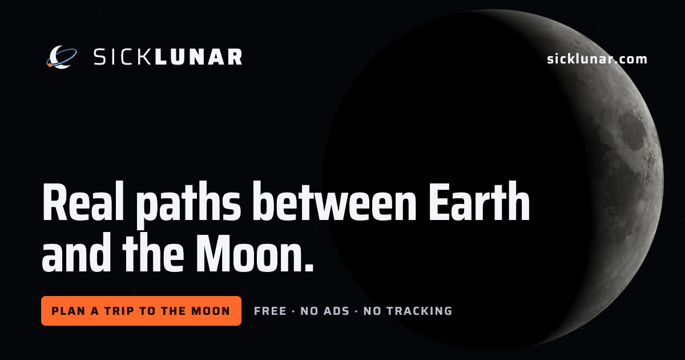
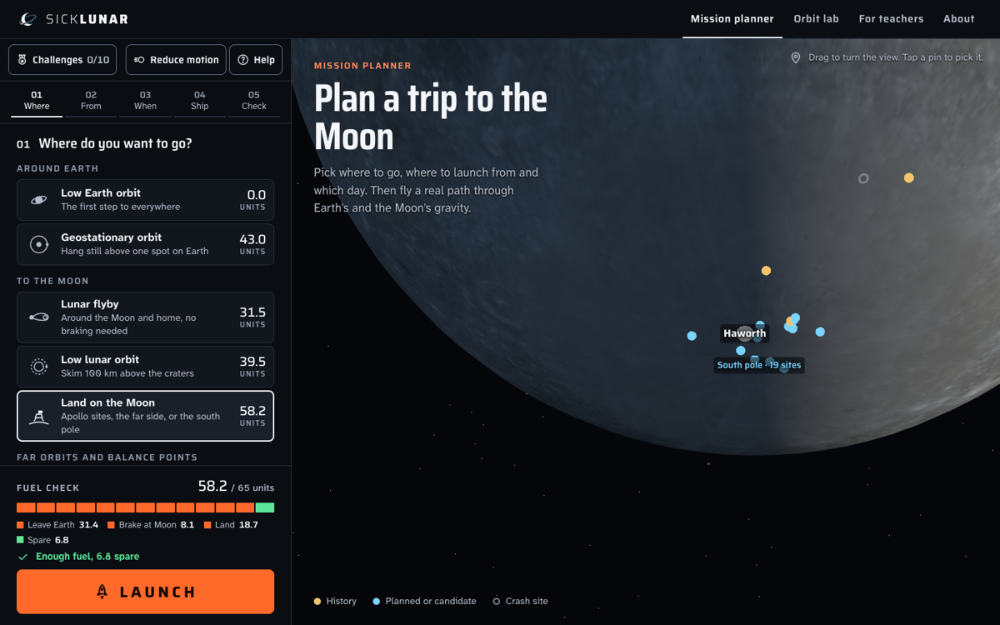
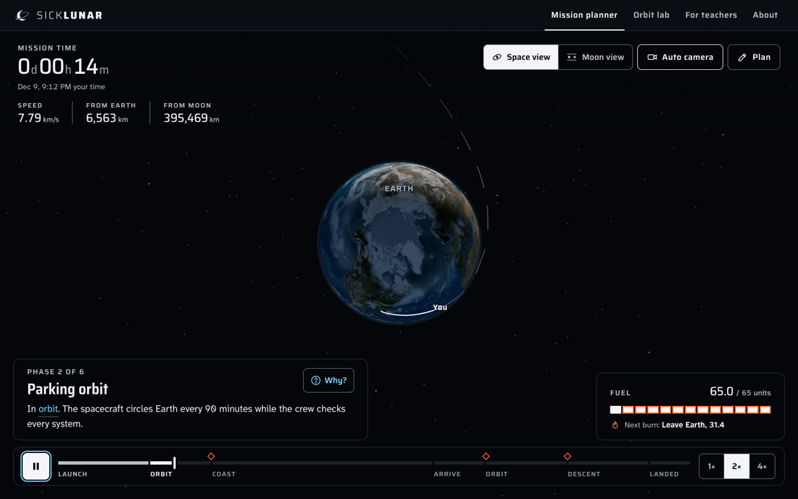
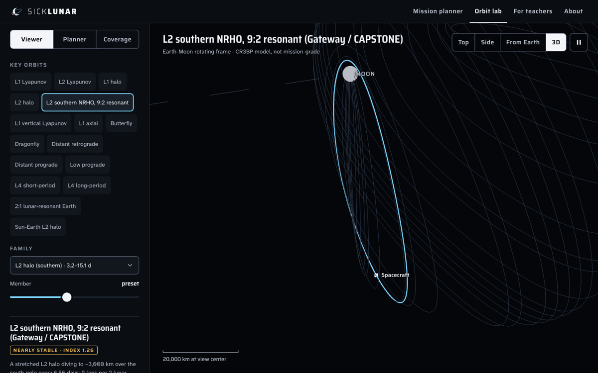

<p align="center"></p>

# Sicklunar

**Real paths between Earth and the Moon.** Plan a trip to the Moon, pick a real launch pad and a launch day, then watch your spacecraft fly a path shaped by Earth's and the Moon's gravity, and see how much fuel every burn costs.

Free, open source, no ads, no accounts, no tracking. Live at **https://sicklunar.com**.

[Plan a mission](https://sicklunar.com/mission) · [Orbit lab](https://sicklunar.com/lab) · [For teachers](https://sicklunar.com/teachers) · [Credits](https://sicklunar.com/about#credits)

<p align="center">
  
  
  
</p>

## What it is

- **Mission Planner** (ages 10 and up): choose one of 10 destinations (low Earth orbit to the lunar south pole), one of 10 real launch sites and a launch day, then fly it. Fuel is counted in simple units (1 unit = 100 m/s of change in speed). Every burn has a "Why?", hard words open a glossary, there are 10 challenges and 47 places on the Moon, from Apollo 11 to the Artemis candidate zones.
- **Orbit lab** (older students and space fans): 48 NASA/JPL periodic-orbit families (42 Earth–Moon, 6 Sun–Earth) and 16 key orbits in 3D; a route planner over 50 cited transfer legs; and a coverage map for watching cislunar space.
- **Physics**: the circular restricted three-body problem (Earth + Moon) for the paths, and real Sun and Moon positions for the chosen date (Meeus). Simplified for learning; see [Accuracy](#accuracy).
- **Privacy**: no accounts, cookies, analytics or third-party requests. Progress is saved only in your browser's local storage.

## Run it locally

```bash
git clone https://github.com/jdoscher/sicklunar && cd sicklunar
python3 -m venv .venv && ./.venv/bin/pip install -e '.[dev]'
./.venv/bin/python -c "from cislunar.export import export; export('web/public/data')"   # generate the app data
cd web && npm ci && npm run dev        # http://localhost:5173
npm test && npm run build              # node tests + static site in web/dist
cd .. && ./.venv/bin/python -m pytest -q
```

Requirements: Python 3.11+ and Node 20+. No API keys. The JPL orbit catalogue is cached in `cislunar/jpl_cache/` (refresh, rarely needed: `python -c "from cislunar import catalog; print(catalog.refresh())"`).

## How it's built

- `cislunar/`: Python engine: CR3BP dynamics (`cr3bp.py`), the JPL periodic-orbit catalogue and cache (`catalog.py`), key orbits, line drawings (`draw.py`), transfer computation (`transfers.py`) and the JSON export for the site (`export.py`).
- `cislunar/research_data/*.json`: cited datasets. Every record has source URLs and a Fact / Reported / Inference label.
- `scripts/build_missions.py`: precomputes the Mission Planner's transfers (`cislunar/mission_data/transfers.json`).
- `web/`: Vite + TypeScript + three.js, no framework. Pages: `index.html` (home), `mission.html`, `lab.html`, `about.html`, `teachers.html`. The built site is fully static; `scripts/serve-dist.py` serves `web/dist` with the same clean URLs as the live site.

Conventions: rotating Earth–Moon frame, nondimensional units (distance = `lunit_km`, time = `tunit_s`, both from the JPL API). Earth at `(-mu, 0, 0)`, Moon at `(1-mu, 0, 0)`. JPL's stability index: 1 = linearly stable, larger = less stable.

## Accuracy

The paths come from a simplified model: Earth and the Moon on circular orbits, the Sun's pull left out, and each burn treated as instant. Moon and Sun positions are accurate to a fraction of a degree. The numbers are close to real missions but not exact: for example, the model's 9:2 near-rectilinear halo orbit comes about 2,930 km from the Moon's surface at its closest, while NASA's planned orbit comes about 3,200–3,560 km. Good for learning, not for real mission planning.

## Credits and licence

Data and images come from NASA, JPL, the Lunar Reconnaissance Orbiter Camera team, and the papers and agencies listed in [CREDITS.md](CREDITS.md).

- Code: [MIT](LICENSE).
- Lesson text and compiled data tables: [CC BY 4.0](LICENSE-content). Please credit "Sicklunar (sicklunar.com), Jay Doscher".
- NASA images: public domain. Fonts: SIL Open Font License 1.1.

## Contributing

Corrections are the most useful contribution: open an issue with the page, what's wrong and a source link. Data fixes go in `cislunar/research_data/*.json` with a `note` on the record. Before a pull request, run `pytest`, `npm test` and `npm run build`. New words a kid would read need a glossary entry in `web/src/mission/content.ts`. Pull requests that add trackers, ads, accounts or external scripts won't be merged.

## Made by

Created by [Jay Doscher](https://doscher.com) to explore and learn about cislunar orbits, built with [Claude](https://www.anthropic.com/claude) (Anthropic) and [Hermes](https://hermes-agent.nousresearch.com) (Nous Research), which helped with the research, the orbit math and the code. An independent, non-commercial project; not affiliated with NASA or any space agency.
